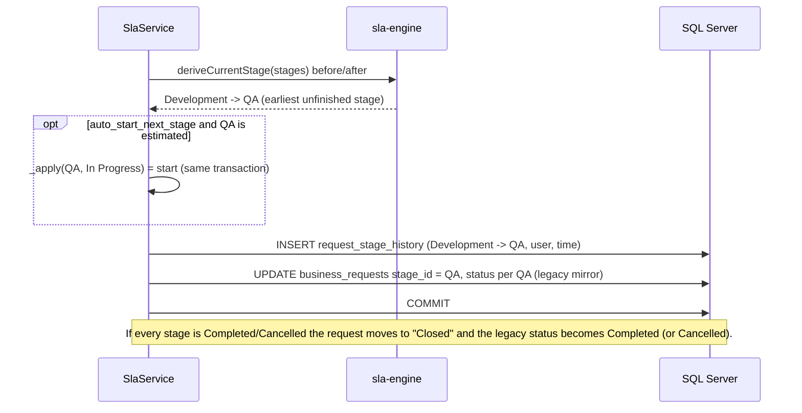

# Stage-driven, effort-driven SLA engine

The SLA is now the sum of per-stage **planned effort (man-days)** and is consumed only while a stage is
**In Progress**. Priority moves the *target*; it never changes the *consumed effort*.
The legacy SLA calculation (`computeSla` in `lib/sla.js`, used by the request list) is untouched.

## 1. What changed and why

| Area | Change | Why |
|---|---|---|
| `db/migrations/001_sla_effort_engine.sql` | **New.** 5 tables + 5 `sla_settings` keys. No existing table/column altered. | Additive = zero risk for the old UI; trivial rollback. |
| `db/database.js` | `init()` now also applies `db/migrations/NNN_*.sql` once each (tracked in `dbo.schema_migrations`); exports `applyMigrations`, `rollbackMigration`. `SKIP_MIGRATIONS=true` disables. | `schema.sql` is "create if missing" only; the migration needs run-once, ordered, reversible scripts. |
| `db/migrate.js` | **New CLI**: `up`, `status`, `backfill`, `down <NNN>`. | Manual/DBA control and rollback. |
| `lib/sla-engine.js` | **New.** Pure functions: working-day math, consumed/hold/remaining, priority-adjusted target, health thresholds, state machine (`planTransition`), initial-state planning, input validation. | No DB/clock/I-O: unit-testable and reusable. |
| `lib/sla-service.js` | **New.** `SlaService`: `startSLA`, `pauseSLA`, `resumeSLA`, `completeStage`, `cancelStage`, `reopenStage`, `updateStageStatus`, `getRequestSla`, `getDashboard`, `syncFromLegacy`, `backfillMissing`, plus `calculateStageSLA/RemainingEffort/ConsumedEffort/ExpectedCompletionDate`. | Orchestration, transactions, audit. |
| `lib/sla-repository.js` | **New.** All SQL (parameterized) behind a small interface. | The service is tested with an in-memory twin (`test/memory-repository.js`). |
| `routes/requestSla.js` | **New.** The 4 endpoints (also under `/api/business-requests/:id/...`). | Matches the requested URLs and the existing naming. |
| `lib/sla.js` | `loadConfig()` returns the engine settings inside `settings` (still flat, `weekend_days` unchanged). | Settings live next to `weekend_days`; UI round-trips them. |
| `routes/sla.js` | `PUT /api/sla/config` validates the new keys and **no longer wipes `sla_settings`** (replaces only `weekend_days` + the keys sent). | The old code did `DELETE FROM sla_settings`, which would have erased the thresholds on every save. |
| `routes/businessRequests.js` | After create / update / bulk-update (stage or status) it calls `syncLegacyRequest()` (never throws). | Edits made in the old form keep the engine consistent. `SLA_ENGINE_SYNC=false` turns it off. |
| `server.js` | Registers the routes; backfills tracking for existing requests at startup (`SLA_BACKFILL_ON_START=false` to skip). | Existing data migration. |

## 2. Database design

`sla_stages.effort_days` (existing) is the **default planned effort** copied into each request's stage when tracking
is created; it can then be changed per request (`plannedEffort` in the POST).
Stages are referenced **by name** (the SLA editor replaces `sla_stages` wholesale), requests by id (cascade delete).

| Table | Purpose |
|---|---|
| `request_stages` | One row per request × pipeline stage: `status`, `stage_effort_days`, `actual_effort_days`, `remaining_effort_days`, `sla_consumed_days`, `total_hold_time`, `started_at`, `completed_at`, `paused_at`, `resume_at`, `reopen_count`, `is_backfilled`. Aggregates are a cache refreshed on each transition. |
| `sla_effort_tracking` | Every In Progress segment (`started_at`, `ended_at`, `end_reason`, `working_days`). **Source of truth for consumed effort.** |
| `sla_pause_history` | Every hold period (`paused_at`, `resumed_at`, `hold_days`, `reason`, who paused/resumed). Never overwritten. |
| `request_stage_status_history` | Audit: stage, `from_status → to_status`, `action`, `source`, effort snapshot, `note`, `changed_by`, `changed_at`. Append-only. |
| `request_stage_history` | Audit: request moved `from_stage → to_stage` (e.g. BA → Development), who, when, why. |
| `sla_settings` (keys) | `at_risk_threshold_pct` (80), `breach_threshold_pct` (100), `priority_factor_mode`, `enforce_stage_order` (true), `auto_start_next_stage` (false). |

Integrity: status `CHECK`; one open work segment and one open hold per stage (filtered unique indexes);
`UQ(business_request_id, stage_name)`. Writes take `UPDLOCK, HOLDLOCK` on the request row, so concurrent changes serialize.
All queries inside a transaction run one after another: a SQL Server transaction has a single connection and rejects overlapping requests
(the in-memory test repository enforces the same rule).

## 3. Rules

**Statuses and SLA effect**

| Status | Effect |
|---|---|
| Not Yet Estimated | No SLA; no planned effort (`NULL`). Needs `plannedEffort` before it can start. |
| Not Started | No SLA, no consumption; remaining = planned. |
| In Progress | Opens a work segment; working days are consumed. |
| On Hold | Closes the work segment, opens a hold period; nothing consumed; history kept. |
| Completed | Closes segments; `actual_effort_days` stored (calendar-derived, or `actualEffortDays` override); request moves to the next stage. |
| Cancelled | Closes segments; remaining effort dropped. Only effort already spent counts in request totals. |

Allowed moves: `NYE→{Not Started, In Progress, Cancelled}`, `Not Started→{NYE, In Progress, Cancelled}`,
`In Progress→{On Hold, Completed, Cancelled}`, `On Hold→{In Progress, Completed, Cancelled}`,
`Completed→{In Progress}` (reopen), `Cancelled→{Not Started, NYE}` (reinstate). Anything else → `409`.
Also: one stage In Progress at a time; earlier stages must be Completed/Cancelled to start a stage
(`enforce_stage_order`; resuming from On Hold is exempt, reopening a completed stage is checked like a start).

**Working days.** A segment covers the working days in *(start day, end day]*, weekends from
`sla_settings.weekend_days`, local server date (same as `todayIso`). Consecutive segments never double count
(consumed + hold = elapsed working days); the day an interval ends on belongs to that interval; a same-day start/stop consumes 0.

**Priority.** `expected = planned adjusted by factor`; `utilization = consumed / expected`.
`priority_factor_mode`: `multiplier` (legacy, Critical 0.4 → `10 × 0.4 = 4`) or `divisor`
(Critical 1.5 → `10 / 1.5 = 6.67`). The migration picks `divisor` if a stored *Critical* factor is above 1, else `multiplier`.
Change it in `sla_settings` (or `PUT /api/sla/config`).
`remaining` is raw `planned − actual`; consumed effort is never adjusted.

**Health** (`utilization` = consumed ÷ priority-adjusted target, thresholds configurable):
`On Track ≤ 80%`, `At Risk > 80% and ≤ 100%`, `Breached > 100%`.
Request health = worst of the overall utilization and every non-cancelled tracked stage (a breached stage stays visible).
Stages created from legacy data (`is_backfilled`) are excluded from totals.

**Expected completion date.** Today + remaining *expected* working days (ceil). For the current stage and for the whole request;
On Hold projects as if resumed today; unestimated stages are excluded and counted in `request.unestimatedStages`.

## 4. API

### `GET /api/requests/:id/sla`
```json
{
  "requestId": 12, "priority": "Medium", "priorityFactor": 1, "priorityFactorMode": "divisor",
  "currentStage": "Development", "status": "In Progress",
  "plannedEffort": 15, "actualConsumed": 4, "remaining": 11, "holdDays": 2,
  "expectedCompletionDate": "2026-12-15", "slaState": "On Track",
  "expectedSlaDays": 15, "utilizationPct": 26.67,
  "request": { "totalPlannedDays": 31, "totalExpectedDays": 31, "totalConsumedDays": 9, "totalRemainingDays": 22,
               "totalHoldDays": 2, "varianceDays": -22, "utilizationPct": 29.03, "slaHealth": "On Track",
               "unestimatedStages": 0, "isFinished": false, "expectedCompletionDate": "2027-01-05" },
  "stages": [ { "stage": "Development", "status": "In Progress", "plannedEffort": 15, "expectedSlaDays": 15,
                "actualEffort": 4, "consumedDays": 4, "remaining": 11, "holdDays": 2, "varianceDays": -11,
                "utilizationPct": 26.67, "slaState": "On Track", "startedAt": "...", "reopenCount": 0 } ]
}
```
The first call for a request created before the engine builds its tracking from the legacy stage/status.

### `POST /api/requests/:id/stage-status`
```json
{ "stage": "Development", "status": "On Hold", "note": "waiting for vendor" }
```
Optional: `plannedEffort` (1–999, 2 decimals), `actualEffortDays` (only with `Completed`), `note` (≤ 500).
Returns the same body as GET plus `"transition": {"stage","from","to","action","changed"}`
(`action`: start, pause, resume, complete, cancel, reopen, reinstate, estimate, unestimate, noop).
`400 {errors}` bad payload · `404` request or stage not found · `409 {errors}` illegal transition / rule violation.
Requires a read/write user (enforced globally by `server.js`).

### Others
`GET /api/requests/:id/sla/history` → `{statusHistory, stageHistory, pauses}` ·
`GET /api/sla/dashboard?priority=&stage=&health=` → `{thresholds, totals, stages[], requests[]}`
(stage level: planned, actual, variance, hold, utilization %; request level: total planned/consumed/hold, health).

## 5. Audit logging

Every change writes, in the **same transaction** as the change: a `request_stage_status_history` row
(`from_status → to_status`, `changed_by` = logged-in user via `resolveChangedBy`, `changed_at`, effort snapshot, `note`, `source` = `api | legacy-sync | migration`)
and, if the request moved (e.g. BA → Development), a `request_stage_history` row. Hold periods and work segments are retained as rows.
Failed/rejected calls write nothing. Rows are never updated or deleted by the app (they cascade only when the request is deleted,
like `business_request_history`).

## 6. Migration strategy

1. **Schema:** `001_sla_effort_engine.sql` runs automatically on start (or `node db/migrate.js up`). Idempotent, purely additive.
2. **Backward compatibility:** legacy tables/columns/`computeSla` and the old form are unchanged. The engine mirrors state back:
   after a stage/status change it updates `business_requests.stage_id` (when the stage moves) and `status_id`
   (`In Progress`, `On Hold`, `Not Started`, `Completed`, `Cancelled` from the lookup, only when the current status would contradict the engine).
   Edits in the old form are reconciled by `syncFromLegacy` (legacy values win; nothing is written back).
3. **Existing data:** `backfillMissing()` (startup, or `npm run migrate:sla-backfill`) creates tracking for requests that have none:
   stages before the current one → `Completed` (`is_backfilled`, no effort history); current stage → `In Progress` / `On Hold` /
   `Not Started` by the legacy status (`Not Estimated` and unconfigured efforts → `Not Yet Estimated`); later stages → `Not Started`;
   Done/Cancelled statuses finish/cancel everything. Consumption **starts at migration time** (the past is unknown).
4. **Rollback:** deploy the previous release, then `node db/migrate.js down 001` (drops the 5 tables and 5 settings;
   take a `BACKUP DATABASE` first if you need the history). To pause the engine without a rollback:
   `SLA_ENGINE_SYNC=false` and `SLA_BACKFILL_ON_START=false`. `SKIP_MIGRATIONS=true` stops startup from re-applying it.

Stage names: the pipeline is whatever `sla_stages` marks `is_pipeline` (today Analysis, BA, Development, QA, UAT, CAB, Deployment).
To use *Planning* instead of *Analysis*, rename/add it in the SLA editor and lookups; nothing in the engine hardcodes names
(only `Closed` is recognised as the terminal stage). Requests keep the stage names they were tracked with.

## 7. Sequence diagrams

### Start SLA
```mermaid
sequenceDiagram
  actor U as User
  participant R as routes/requestSla
  participant S as SlaService
  participant E as sla-engine
  participant DB as SQL Server
  U->>R: POST /requests/12/stage-status {Development, In Progress}
  R->>S: updateStageStatus(12, body, user)
  S->>E: validateStageStatusInput
  S->>DB: BEGIN; SELECT request WITH (UPDLOCK); load stages
  S->>E: planTransition(Not Started -> In Progress)
  E-->>S: action = start (estimate present, order ok, no other active stage)
  S->>DB: INSERT sla_effort_tracking (open segment)
  S->>DB: UPDATE request_stages (status, started_at)
  S->>DB: INSERT request_stage_status_history
  S->>DB: UPDATE business_requests (legacy status "In Progress")
  S->>DB: COMMIT
  S-->>R: SLA status
  R-->>U: 200
```

### Pause SLA
```mermaid
sequenceDiagram
  actor U as User
  participant S as SlaService
  participant E as sla-engine
  participant DB as SQL Server
  U->>S: POST stage-status {Development, On Hold, note}
  S->>DB: BEGIN; lock request; load stage + segments
  S->>E: planTransition(In Progress -> On Hold) = pause
  S->>DB: UPDATE sla_effort_tracking SET ended_at, end_reason='Hold', working_days
  S->>DB: INSERT sla_pause_history (paused_at, reason, paused_by)
  S->>E: calculateConsumedEffort / calculateHoldDays
  S->>DB: UPDATE request_stages (status, paused_at, sla_consumed_days, total_hold_time, remaining)
  S->>DB: INSERT request_stage_status_history; sync legacy status "On Hold"
  S->>DB: COMMIT
  S-->>U: 200 (consumption frozen, hold clock running)
```

### Resume SLA
```mermaid
sequenceDiagram
  actor U as User
  participant S as SlaService
  participant E as sla-engine
  participant DB as SQL Server
  U->>S: POST stage-status {Development, In Progress}
  S->>DB: BEGIN; lock request; load stage + segments
  S->>E: planTransition(On Hold -> In Progress) = resume (order rule skipped)
  S->>DB: UPDATE sla_pause_history SET resumed_at, hold_days, resumed_by
  S->>DB: INSERT sla_effort_tracking (new open segment)
  S->>DB: UPDATE request_stages (status, paused_at = NULL, resume_at, total_hold_time)
  S->>DB: INSERT request_stage_status_history; sync legacy status "In Progress"
  S->>DB: COMMIT
  S-->>U: 200
```

### Complete stage
```mermaid
sequenceDiagram
  actor U as User
  participant S as SlaService
  participant E as sla-engine
  participant DB as SQL Server
  U->>S: POST stage-status {Development, Completed, actualEffortDays?}
  S->>DB: BEGIN; lock request; load stage + segments
  S->>E: planTransition(In Progress|On Hold -> Completed) = complete
  S->>DB: close open work segment (end_reason='Completed') and any open hold
  S->>E: calculateConsumedEffort
  S->>DB: UPDATE request_stages (status, completed_at, actual_effort_days = override ?? consumed, remaining = 0)
  S->>DB: INSERT request_stage_status_history (effort snapshot)
  Note over S,DB: continues with "Move to next stage"
```

### Move to next stage


## 8. Tests

`npm test` (Node's built-in runner, no extra dependencies):

* `test/sla-engine.test.js` — unit: weekend handling, priority modes, multi-cycle hold, remaining effort, thresholds,
  state machine, initial-state planning, validation.
* `test/sla-service.integration.test.js` — integration: real router + handlers + service over HTTP against `test/memory-repository.js`:
  lifecycle, multiple pause/resume, priority vs consumption, 400/404/409 rules, reopen, override, cancel, auto-start,
  rollback on failure, legacy reconciliation, backfill, dashboard, configurable thresholds.

**Not covered by automated tests:** the SQL text itself (the memory repository replaces it). Smoke test against a scratch SQL Server database:
start the app (migration + backfill run), then `GET /api/requests/<id>/sla`, `POST .../stage-status` through
In Progress → On Hold → In Progress → Completed, and check `request_stage_status_history`, `sla_pause_history`, `sla_effort_tracking`;
finally `node db/migrate.js down 001` then `up` to prove the rollback.

## 9. Screens

* **"Stage SLA" tab** (`public/stage-sla.js`): health tiles (On Track / At Risk / Breached), planned/consumed/hold totals,
  a by-stage table (planned, actual, variance, hold, utilization) and a worst-first request table with a health filter; click a row to open the request.
* **Request details drawer -> "Stage SLA (effort-driven)"** (business requests only): current-stage headline, request totals and health, a stage table
  with per-stage actions (Start, Hold, Resume, Complete, Cancel, Reopen, Reinstate, Estimate, edit planned effort) behind read/write permission,
  and an expandable SLA history. Actions ask for the note / estimate / actual effort in a small dialog.
* **SLA Settings -> General**: thresholds, priority factor mode, stage-order rule, auto-start next stage.

## 10. Known limits

* Day-granular: a stage started and stopped on the same day consumes 0; there is no business-hours or per-person allocation.
* Timestamps cannot be backdated through the API (the server clock is used).
* Stages that leave the pipeline after a request was tracked are ignored (kept in the database, excluded from calculations) unless they were
  actually used; stages that join the pipeline are added to tracked requests the next time the request is read or changed, and by the startup
  backfill. A removed stage that is still running on a request nobody has used the engine on is rebuilt from the legacy stage/status.
* Requests created by the Excel/CSV import get tracking at the next startup backfill (or on first view).
* Category factors (used by the legacy calculation) are not applied by this engine.
* The dashboard request list is not paginated (it scrolls), and there are no bulk stage actions.
